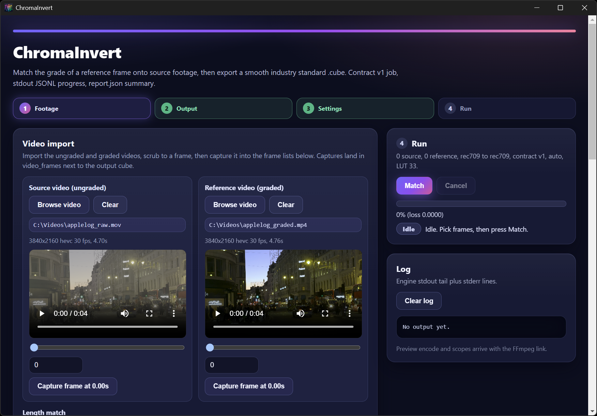

# ChromaInvert

Video LUT reverse engineering. It takes source footage and a reference grade and writes a smooth 33x 3D LUT as `.cube` that loads in FFmpeg, Resolve, and Premiere Pro.

Built for the Meta Global AI Developer Hackathon (Oct 26 to Nov 4, 2026), Indie track. Team Jayly. License: Apache-2.0.

## Meta Global AI Hackathon 2026: submission overview

- Track and problem statement: Indie Developer, Build for Your World. Portable color matching for creators and small post houses.
- Provenance (Oct 26 to Nov 4, 2026): built 100 percent from scratch during the hackathon window.
- Meta AI usage: Muse Spark series wrote the engine and GUI code. Muse Wonder reviewed architecture and PRs (see `docs/PROGRESS.md`). The grading run itself is local (PyTorch plus FFmpeg) with no model API calls and no network.
- Bonus prize targeted: Best Creative Build.
- Demo video (3 min): https://www.youtube.com/watch?v=0d8jhrCcYSA
- Keyless check: `python scripts/run_benchmark.py` runs with no footage, no GPU, and no keys. It gates on 40 percent DeltaE2000 improvement.
- Repo: https://github.com/JaylyDev/ChromaInvert, one self-contained public repo.

## Why this exists

Hand grading a log clip to match a film still takes hours. Per frame style transfer is fast but it edits each frame on its own, so flat areas flicker. A 3D LUT is one fixed map from input color to output color. The same input gives the same output on every frame, so the result is stable and it loads in normal editors.

## Results

Measured Oct 29, 2026 on internal video footage, an RTX GPU. Optimiser run: 400 coarse steps plus 30 fine steps. Re-measure on the demo machine.

| Check                               | Number                                                                  |
| ----------------------------------- | ----------------------------------------------------------------------- |
| Synthetic recovery, held out frames | Baseline 4.04, recovered 2.06 mean DeltaE2000, 48.9 percent improvement |
| End to end                          | 31.1s total (extract 2.9, optimize 12.5, export 6.9, benchmark 6.3)     |
| Smoothness                          | max neighbor delta 0.161, no banding on ramp test                       |
| Python vs FFmpeg trilinear          | Mean DeltaE2000 0.22 to 0.26                                            |

Full gates and probe numbers are in `report.json` and `docs/PREMIERE_VALIDATION.md`.

## Quickstart

Start with the app. Grab the installer from GitHub Releases and launch ChromaInvert (see Download and use the GUI below). Pick a source clip and a reference frame. Choose the output `.cube` path and press Match. The packaged app captures with Chromium and falls back to system FFmpeg on PATH, and installs the engine via pip on first run.



To build that installer from source:

```powershell
cd app/gui
npm ci
npm run typecheck
npm run build
npm run dist
```

Installers land in `app/gui/release/`. For dev, run `npm run dev` plus `npm run electron:dev` in a second terminal.

## Download and use the GUI

Prebuilt installers are attached to each GitHub Release (`v*` tags): https://github.com/JaylyDev/ChromaInvert/releases

- Windows: run `ChromaInvert Setup <version>.exe` to install, or launch the portable `ChromaInvert <version>.exe` with no install. The builds are unsigned, so SmartScreen may ask for confirmation on first launch.
- macOS: open the `.dmg` and drag ChromaInvert to Applications. The build is unsigned, so if Gatekeeper blocks the first launch, right-click the app and choose Open.
- Linux: make the `.AppImage` executable and run it, or install the `.deb` with `dpkg -i`.

First run: video import uses Chromium first with system FFmpeg on PATH as fallback for codecs Chromium cannot play. The engine installs once via the Environment panel: press Install engine with Python 3.10 or newer on PATH and internet access (installs `chromainvert` from PyPI with torch, numpy, and imageio; it can take several minutes). Reference-only predict mode additionally needs a weights `.pt` file: train one with `scripts/train_lut_predictor.py` and pick it in the weights field.

Basic Match workflow in the app:

1. Footage: add ungraded source frames and graded reference frames, or import the source and reference videos and capture matching frames into the lists.
2. Output: pick the output `.cube` path (`job.json` and `report.json` land next to it).
3. Grade settings: the input profile decodes the source frames and the reference profile decodes the graded reference (Auto resolves log sources such as Apple Log to `rec709`). Strength blends the result back toward identity.
4. Run: press Match and watch the progress bar, status, and log; Cancel stops the engine. Load the exported cube as the Input LUT in Premiere (Apple Log cubes expect the Lumetri Input LUT slot), or apply it with FFmpeg `lut3d`.

Use the engine directly for the keyless check or for scripting. Needs Python 3.10 or newer, FFmpeg 7 or newer with ffprobe on PATH. A CUDA torch build helps; CPU runs slower.

```powershell
python -m venv .venv --system-site-packages
.venv\Scripts\Activate.ps1
python -m pip install -e ./engine
python -m pytest engine/tests -q
python scripts/run_benchmark.py
```

One command demo (writes `work/demo/` with `out.cube`, `graded.mp4`, `before.png`, `after.png`, `report.json`):

```powershell
python scripts/run_demo.py --source "<clip.mov>" --reference "<reference.mov>" --workdir work/demo
```

For anything else, read the source doc: run of show in `docs/DEMO_SCRIPT.md`, frame job example in `assets/job.json.example`, GUI build in `app/gui/README.md`.

## How it works

Electron writes `work/job.json` and spawns `python -m chromainvert run`. The engine starts from identity (coarse 17, Catmull-Rom to 33) and runs Adam on Oklab quantile and moment terms with TV smoothing plus skin and shadow anchors. Export bakes the map into host code values and writes red-fastest `.cube`. Contract in `docs/ARCHITECTURE.md`.

## Layout

- `engine/chromainvert/`: color decoders, losses, optimizer, predictor, CLI
- `engine/tests/`: one test module per engine module
- `app/gui/`: Electron plus React product GUI
- `scripts/`: demo and validation helpers
- `docs/`: plan, architecture, demo script, Premiere checks, build log
- `data/`: bring your own LUTs and weights (gitignored, no checkpoint shipped)
- `work/`: gitignored runtime output

## Validation

```powershell
python scripts/validate_cube.py
python scripts/run_benchmark.py
python scripts/premiere_validation.py
```

CI runs pytest on Ubuntu and GUI typecheck plus build on Windows, macOS, and Linux.

## Limits

- `rec709` is the tested path. `slog3` and Apple Log use a bounded working space with a host domain bake; saturated log colors carry interpolation error (mean abs error under 0.02 on random codes). See `docs/ARCHITECTURE.md` step 4.
- Premiere Pro color manages Apple Log toward Rec.709 before Lumetri, so cubes for Premiere must be trained from Premiere exports or the host domain path. Steps in `docs/PREMIERE_VALIDATION.md`.

## License

Apache-2.0, see `LICENSE`.

`work/`, `.venv/`, checkpoints (`*.pt`), and local footage stay out of git.
